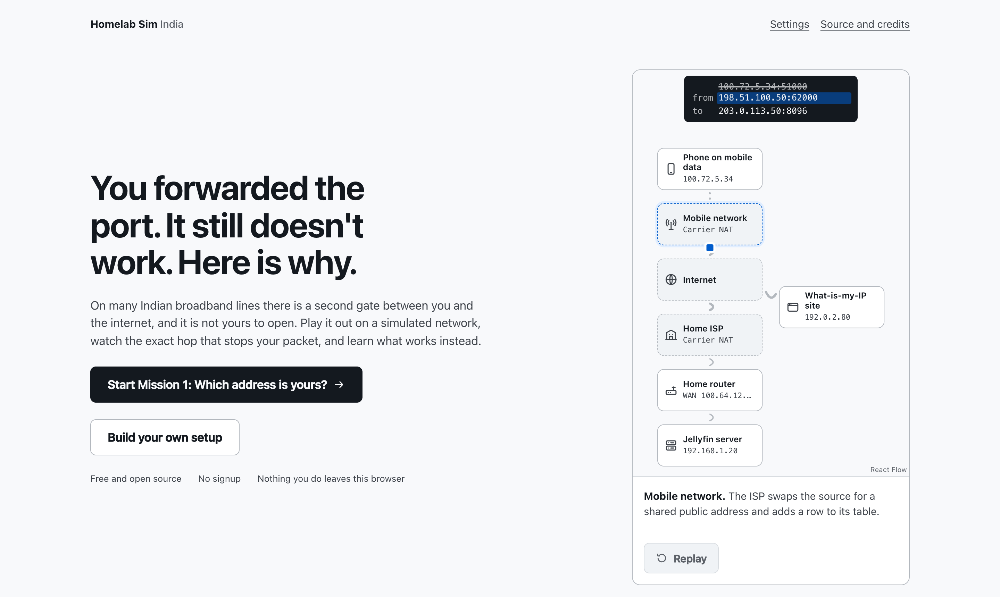
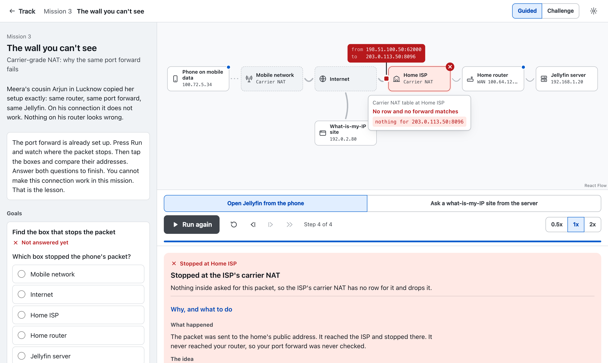

<div align="center">

# Homelab Sim India

**You forwarded the port. It still doesn't work. Here is why.**

A free, open-source simulator that teaches home networking and self-hosting on real Indian internet lines, including CGNAT.

[](https://github.com/inevitable-lettus/homelab-sim-india/actions/workflows/ci.yml)
[](https://github.com/inevitable-lettus/homelab-sim-india/actions/workflows/deploy.yml)
[](LICENSE)
[](LICENSES/CC-BY-SA-4.0.txt)
<br>
[](crates)
[](app)
[](#privacy)
[](CONTRIBUTING.md)

### [▶ Try it in your browser](https://inevitable-lettus.github.io/homelab-sim-india/)

No signup. Nothing you do leaves your browser.



</div>

---

## What is this?

Most homelab guides say "just forward a port". On many Indian broadband lines that fails, and nothing tells you why. The ISP has a second gate (carrier-grade NAT) that you cannot see or open.

Homelab Sim lets you play this out on a simulated network:

1. Build or pick a setup.
2. Press **Run** and watch every packet, step by step.
3. See the exact box that stops it, and why.
4. Learn the fix that works on your kind of line.

It is made for college students, beginners and hobbyists.

<div align="center">

<br><sub>Mission 3: the port forward is correct, but the packet stops at the ISP's carrier NAT.</sub>
</div>

## Features

- **Five missions on remote access.** Each has a guided depth and a challenge depth.
  | # | Mission | You learn |
  |---|---|---|
  | 1 | Which address is yours? | Home, WAN and public addresses |
  | 2 | Open a door | Port forwarding on a line with a public address |
  | 3 | The wall you can't see | Why the same port forward fails behind CGNAT |
  | 4 | Dial out to get in | Outgoing connections, NAT rows and a mesh VPN |
  | 5 | Write the tunnel | A WireGuard config, written by hand |
- **Packet playback.** Pause, step back and forward, and change speed.
- **A real Linux terminal** in the browser for Mission 5. The simulator checks your files.
- **Build your own.** Pick devices, services and power backup. See if it will run, what it costs per year in ₹, and what a power cut does.
- **Plain explanations** with everyday Indian examples, and links to the standards.
- **Honest answers.** If we have no data for something, the app says "unknown". It never guesses a pass.

## Privacy

- No backend, no accounts, no tracking.
- The app never collects your IP address or your results.
- Progress is saved only in your own browser.

## Run it locally

You need Node 24+, [Rust via rustup](https://rustup.rs) and a POSIX shell.

```bash
npm run setup
```

```bash
npm run dev
```

Before sending a change, run the same check CI runs:

```bash
npm run check
```

Browser tests:

```bash
npm run e2e
```

## How it works

```
YAML data (data/, content/, missions/)  ──►  static JSON bundle
                                                   │
Rust core (crates/)  ──►  WebAssembly  ──►  React app (app/)  ──►  static site
```

- A **deterministic Rust core**, compiled to WebAssembly, decides every result. The UI never decides.
- Device and ISP facts live as **YAML files in git**. Every claim has a source and a date. A new device is one YAML file, with no code change.
- The whole thing ships as a **static site**.

More detail: [Architecture.md](context-docs/Architecture.md). Current state and build order: [Handoff.md](context-docs/Handoff.md).

## Project layout

| Folder | Holds |
|---|---|
| `app/` | React UI and browser tests |
| `crates/` | Rust simulation core |
| `data/` | Device, OS, service, power and ISP data |
| `missions/` | Mission definitions |
| `content/` | Explanations, step text and sandbox templates |
| `curriculum/` | Curriculum notes and the learner test kit |
| `context-docs/` | Design and architecture docs |

## Contributing

Help is welcome, especially sourced data about Indian ISPs and devices. See [CONTRIBUTING.md](CONTRIBUTING.md) and [Data-Backlog.md](context-docs/Data-Backlog.md).

## Licence

- Code: [AGPL-3.0-only](LICENSE)
- `data/`, `content/`, `missions/` and `curriculum/`: [CC BY-SA 4.0](LICENSES/CC-BY-SA-4.0.txt)
- Reused third-party code: [THIRD_PARTY.md](THIRD_PARTY.md)
