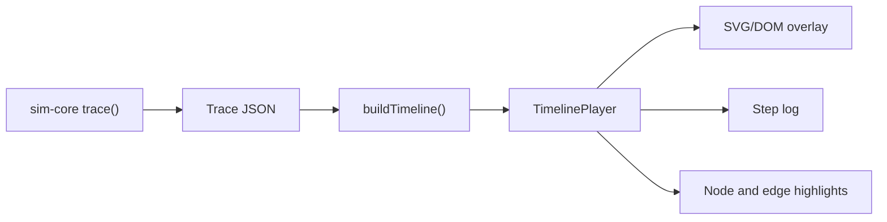

# Animations

Motion in this product is **instructional**. It shows cause and effect in a network: where a packet went, what changed it, and where it stopped. If an animation doesn't teach or confirm something, it doesn't ship.

Values below are starting points. Tune them on real devices, and keep the real numbers in `app/src/lib/motion.ts`, never inline.

## Rules

1. **The core decides, the animation replays.** All network animation is playback of a `Trace` from the Rust core ([Architecture.md](Architecture.md)). No animation code may decide whether a packet gets through.
2. **Motion is scrubbable.** Learners can play, pause, step forward and back, and change speed. The lesson is often in one hop.
3. **Every step has a text line.** The step log is the canonical record. Animation is a view of it.
4. **One thing at a time.** One moving packet by default, with a hard limit of three on screen. Comparisons play in sequence.
5. **Only `transform` and `opacity`.** No animating layout, SVG geometry attributes or filters.
6. **No per-frame React state.** Playback writes to refs and DOM directly.
7. **Same trace, same playback.** Given a trace and a speed, frames are reproducible, which is what makes them testable.

## Pipeline

`buildTimeline(trace, tokens)` is a pure function that returns a list of timed segments. It is unit-tested without a browser.

`TimelinePlayer` owns the clock and exposes `play`, `pause`, `seek`, `stepForward`, `stepBack` and `setSpeed`. Packet position comes from `getPointAtLength` on the React Flow edge's path, and is applied as a `transform` on one overlay element above the board. The Web Animations API covers simple one-off transitions. No animation library at the start; add one only if a real need appears.

The overlay element lives inside React Flow's viewport (`ViewportPortal`), so it is positioned in flow coordinates and follows pan and zoom with no re-reading. The Phase 1 spike measured 0 px of drift. The label is counter-scaled by `1 / zoom` so it stays the same size on screen, and it flips sides near the board edge.

## Tokens (starting values)

| Token | Value | Used for |
|---|---|---|
| `dur.instant` | 80 ms | Press feedback |
| `dur.fast` | 160 ms | Hover, small state changes |
| `dur.base` | 240 ms | Panels, finding appearing |
| `dur.hop` | 520 ms | One packet hop at 1x |
| `dur.rewrite` | 480 ms | Header value changing at a NAT |
| `dur.pause` | 280 ms | Rest at a node between hops |
| `dur.drop` | 420 ms | Packet stopping and failing |
| `dur.win` | 700 ms | Mission success moment |
| `ease.out` | `cubic-bezier(0.22, 1, 0.36, 1)` | Things arriving |
| `ease.inOut` | `cubic-bezier(0.65, 0, 0.35, 1)` | Packet travel |
| `ease.in` | `cubic-bezier(0.55, 0, 1, 0.45)` | Things leaving |
| `speed` | 0.5x, 1x, 2x | Playback |

## Catalogue

| Moment | What the learner sees | Teaches |
|---|---|---|
| Packet hop | A labelled packet travels along a cable to the next node | Path, one hop at a time |
| **NAT rewrite** | Packet pauses at the router; the source address visibly changes: old value struck through above, new value below. Never cross-fade them in the same place | NAT changes addresses |
| **Mapping created** | An outbound packet adds a row to the NAT table at that node | Why replies can return |
| **CGNAT wall** | An inbound packet reaches the ISP's carrier NAT, finds no mapping row, and stops there, short of the home router | The forward at home never had a chance |
| Port forward hit | Inbound packet matches a highlighted forward rule | What a forward does |
| Tunnel build | A connection draws outward from home to the relay first | Outbound-first |
| Tunnel carry | Packet enters a sleeve around the link; the outer addresses show, then it unwraps | Encapsulation |
| IPv6 direct | Packet passes the NAT nodes by a direct path, then meets the firewall | No NAT, firewall still applies |
| Firewall decision | Rule row highlights, allow or deny | Which rule decided |
| DNS lookup | Short query out and answer back before the main packet starts | Names resolve first |
| Drop | Packet stops at the exact hop, marked, with the reason opening beside it | Precise failure location |
| Service boot | Dependencies check in order: OK, degraded or failed | Startup order |
| Power cut | Mains line goes out, unprotected devices dim, UPS or inverter takes over, runtime drains | What survives an outage |
| Power restored | Machines return only if restore-on-power is set; tunnel reconnects | Unattended recovery |
| Finding appears | Slides 8px and fades in; involved nodes pulse once | Links finding to the board |
| Mission win | Delivered packet settles, one restrained confirmation | Completion |
| Grade from files | The learner's file lines light up as the sim reads them into the config | Your file changed the network |

The NAT rewrite, mapping and CGNAT wall are the most important animations in the first track, so they get the most polish. Labels must be readable at 1x at 360px wide: use short values such as `192.168.1.20`, and collapse ports when space is tight.

## Reduced motion

With `prefers-reduced-motion: reduce`, or the in-app setting:

- Packets do not travel. The current step's node and edge are highlighted, and the step log advances.
- Address changes appear as a static before and after.
- Autoplay is off. Learners step by hand.
- The landing trace is a static diagram.

Every lesson must be fully understandable in this mode. This is a requirement, not a degraded fallback.

## Performance

- Target 60 fps on desktop, and at least 30 fps on a low-end Android phone. The Phase 1 spike held 60 fps under 6x CPU throttling in desktop Chrome; a real phone is still untested.
- One overlay layer for packets. Apply `will-change: transform` only during playback.
- Stop the clock when paused or when the tab is hidden.
- Never run traces or evaluate rules inside a frame callback. Compute first, then play.
- Long sequences cap at about 12 seconds at 1x. Beyond that, split them or skip repeated hops.

## Avoid

- Decorative particles, ambient pulses, background motion, parallax.
- Bouncy or elastic easing on technical content.
- Infinite animations, except a paused-state indicator.
- Page transition effects that delay reaching the mission.
- Linear presentation-style fades.
- Blocking input during playback. Learners can always interrupt.

## Testing

- Unit test `buildTimeline` output for each fixture trace.
- Playwright: seek to named steps, and snapshot the board, in light, dark and reduced motion.
- Assert the step log matches the trace exactly, because it is the accessible version.
