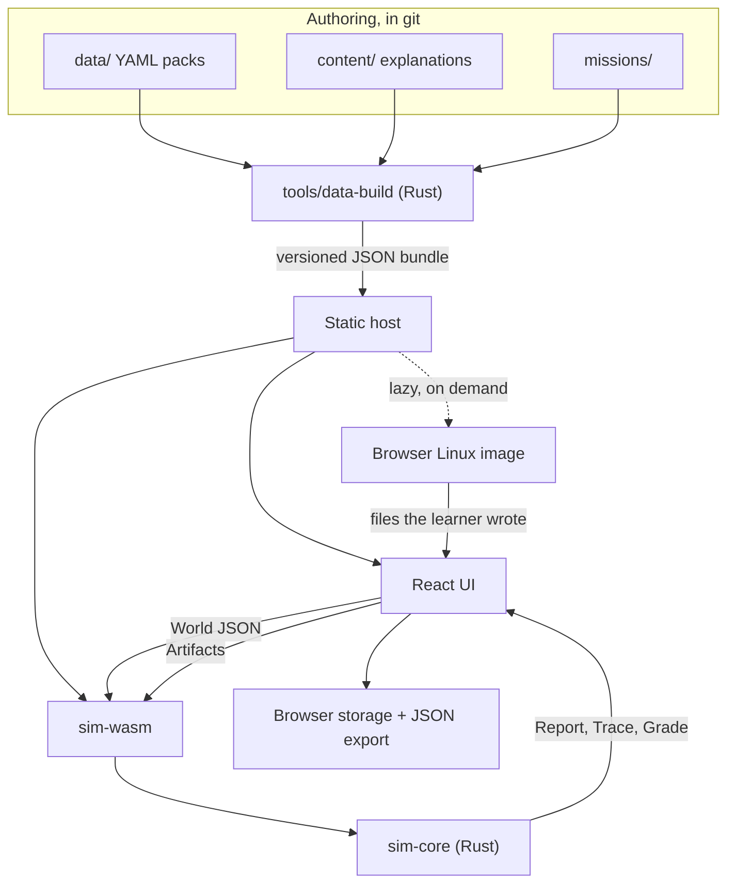

# Architecture

How the system's parts fit and what each is allowed to do. **Status (2026-11-10): no code exists yet.** This is the target design. Read [Handoff.md](Handoff.md) first for current state and for which decisions are confirmed.

## System map



There is no backend, no account system and no runtime API. Everything the app needs is a static file.

## Repo layout (target)

```
crates/sim-core/      Rust library. Pure logic. No wasm, DOM, clock or randomness.
crates/sim-wasm/      Thin wasm-bindgen wrapper: JSON in, JSON out.
tools/data-build/     Validates data packs and emits the JSON bundle.
app/                  TypeScript + React + React Flow UI.
data/archetypes/      Generic teaching machines, one file each.
data/devices/         Real devices, one file each. Empty at launch.
data/isps/            Indian ISP profiles, one file each.
data/services/        Software learners place on hosts.
data/os/              Operating systems and hypervisors (sandbox).
data/runtimes/        Container runtimes (sandbox).
data/power/           State tariffs (tariffs/) and outage scenarios (outages/).
data/reference/       Reference tables, such as media bitrates (sandbox).
content/sandbox/      Sandbox templates.
content/explanations/ Teaching text, one Markdown file per concept.
missions/             Mission definitions, one directory each.
curriculum/           Whole-curriculum documentation in Markdown.
context-docs/         These files.
```

## Boundaries

1. **The UI never decides validity or outcome.** It renders what the core returns.
2. **The core is deterministic.** Same input, same bytes out. No clock, randomness, floats in decisions or hash-ordered iteration (use `BTreeMap`).
3. **The core never touches the DOM or the network**, and is testable as a plain Rust library.
4. **Rules read capabilities, never product names.** A rule may ask `nic_count` or `arch`, never `model == "EQ12"`. This is what makes device data modular.
5. **Learner data stays in the browser.** The app never transmits a learner's IP address, ISP result, or build.
6. **No LLM in the runtime.** Verdicts come from tested rules.

## World model

The world is **one graph**, not three stacked layers. Nodes are physical machines, virtual machines, containers, services, network segments and the ISP. Edges are cables, hosting (`runs_on`) and logical dependencies.

The physical → network → services split survives as **curriculum order and UI grouping only**. It cannot be an evaluation order because real homelabs cross it: a firewall VM is a hosted workload acting as the network's router, and Pi-hole is a service providing the network's DNS.

Hosting nests explicitly: `machine → hypervisor → VM or LXC → container runtime → service`. Virtual bridges are network segments.

### Evaluation

```rust
pub fn evaluate(world: &World, bundle: &Bundle) -> Report;          // facts, findings, one trace per attempt
pub fn trace(world: &World, attempt: &Attempt, bundle: &Bundle) -> Trace;
pub fn grade(mission: &Mission, depth: Depth, world: &World, artifacts: &Artifacts, bundle: &Bundle) -> Grade;
pub fn resolve_target(world: &World, target: &Target, bundle: &Bundle) -> Resolved;
```

`evaluate` derives addresses by iterating to a **fixed point** with a bounded iteration count and stable ordering (`facts.rs`), then runs rules over the result (`rules.rs`) and traces every attempt in the world (`walk.rs`, `trace.rs`). Hitting the bound is a reported finding (`evaluation-did-not-settle`), never a silent stop.

A `Grade` carries the whole `Report`, so the UI makes one call per change. The connection attempts (`Attempt`) are part of the world, so "what the learner is trying" is data, not UI state.

A half-built world is normal. Rules report what they can, and nothing gates later checks.

**Unknown line type.** When an ISP's line type is unknown and no line check has been done, an attempt is traced under each possibility. If every case ends the same way, that is the answer and the trace says which case it shows (`assumed`). If they differ, the answer is `Unknown` with reason `line-type-unknown`. The learner's line check beats profile data, and "can't find it" is itself an answer that yields `Unknown`.

**Reasons.** Every step, drop, finding and goal result carries a `Reason` (`reason.rs`). Its id is also the id of its explanation text, and the data build fails if any reason has no text. Adding a reason is one enum line and one entry in `content/steps.yaml`.

### Verdicts are three-valued

```rust
pub enum Status { Pass, Fail, Unknown }

pub struct Finding {
    rule_id: RuleId,
    status: Status,
    severity: Severity,        // Error | Warning | Info
    involved: Vec<NodeId>,
    explanation_id: ExplanationId,
    provenance: Provenance,    // Official | Community | Teaching | LineCheck
}
```

Missing data produces `Unknown`, which the UI must show. **A rule may never treat a missing value as a pass.** This is the main guard against false "this will work" answers.

## Network logic for the remote-access track

Logic-level, not packet-level: one representative packet per leg, walked hop by hop. The core models what decides reachability:

- Address classes: LAN private, CGNAT `100.64.0.0/10` (RFC 6598), public IPv4, global IPv6.
- NAT mapping tables at the home router and, when present, the ISP's carrier NAT. An inbound packet needs an existing mapping or a forward rule at **every** NAT it crosses. Mappings have an idle timeout and an age.
- Outbound-initiated connections create mappings. This is why tunnels and overlay VPNs work behind CGNAT, and the concept the track teaches.
- Tunnels: WireGuard with explicit peers, and a mesh overlay that the core turns into hub-and-spoke through its relay (always relayed, a stated model limit). Keepalives set the mapping age; a tunnel with no keepalive has mappings as old as the attempt's `idle_s`.
- IPv6 reachability, including whether the client side has IPv6 and whether the router firewall admits it.
- Host firewalls, loopback-only services, DNS names, and port conflicts on one host.

A `Trace` is an ordered list of legs (`setup` for tunnels dialling out, then `request`, then `reply`), each an ordered list of steps. The UI only plays it back ([Animations.md](Animations.md)).

```rust
pub struct Step {
    at: Id,
    action: StepAction,          // Send | Forward | Rewrite | Encapsulate | Decapsulate | Drop | Deliver | Unknown
    packet: PacketView,          // as it leaves this node
    before: Option<PacketView>,  // as it arrived, when the node changed it
    reason: Reason,
    via_link: Option<Id>,
    timing: Option<HopTiming>,   // propagation, serialization, queue, fixed and processing delay
    table: Option<TableEvent>,   // the NAT row or forward that decided it
}
```

### Physics

All of it is integer arithmetic in `physics.rs`, so results are byte-identical everywhere. Missing inputs give `None`, which the UI shows as "unknown". Every number the UI shows comes from here.

| Quantity | Model | Unit |
|---|---|---|
| Propagation | length x a per-medium constant: 4900 ps/m in fibre and backbone, 5000 in copper, 3336 in air | ns |
| Serialization | packet bits / link rate | ns |
| Queueing | M/D/1 mean wait from the link's load, `rho / (2 (1 - rho))` service times | ns |
| Fixed delay | per link (`extra_ns`), such as radio scheduling on a mobile link | ns |
| Processing | a constant per node kind | ns |
| MTU | per link, default 1500. WireGuard adds 60 bytes over IPv4 and 80 over IPv6, default tunnel MTU 1420 | bytes |
| Transfer time | bytes on the wire, with headers and wrappers, over the spare rate of the slowest link | ms |

These are estimates of a teaching model and the UI labels them so. Link lengths and rates in the missions are invented, not measured.

## Real terminal

Browser Linux has no real internet path, so it **cannot** sit behind CGNAT or join a tailnet. The division of work is:

- The learner runs real commands and edits real files in browser Linux.
- On "Check", the UI reads the files the mission names and passes them to `grade` as `Artifacts`.
- Rust parsers (WireGuard config, the compose subset, `sshd_config` subset) turn files into facts in the world, and the logic sim decides whether the connection would work.

```ts
interface TerminalHost {
  boot(image: GuestImage): Promise<void>;
  writeInput(data: string): void;
  onOutput(cb: (data: string) => void): void;
  readFile(path: string): Promise<Uint8Array>;
  writeFile(path: string, data: Uint8Array): Promise<void>;
  dispose(): void;
}
```

**Engine: [v86](https://github.com/copy/v86)** (BSD-2-Clause), confirmed by the Phase 1 spike. It exposes `read_file`, `create_file` and `serial0_send`. It runs without cross-origin isolation headers (measured). Limit: 32-bit guest. [container2wasm](https://github.com/container2wasm/container2wasm) (Apache-2.0) was the fallback and was not needed. Keep the interface engine-neutral.

Rules from the spike (numbers in [Handoff.md](Handoff.md), Phase 1):

- **Always start from a saved state.** A cold boot took 83 s under 6x CPU throttling; the saved state took under 1 s. The state is built in Node, so CI can produce it.
- The engine build, the filesystem index, the rootfs and the state are **one versioned set**. A state does not load against a different build of any of the others.
- Guest RAM is 128 MB. The browser tab still used 400 to 815 MB, so on phones the file editor is the default and the terminal is an opt-in.
- `read_file` sees guest writes immediately with the 9p option `cache=loose`. Grading does not need the learner to run `sync`.

Because grading reads artifacts rather than the VM, a **plain text editor can stand in for the terminal** on devices that cannot run it. The same grader applies.

The guest image must be small, lazy-loaded, and started only on request, showing its download size first.

## Data packs and the modularity contract

Adding hardware must be easy. **Adding a device means adding one YAML file and running the data build. It must never require a code change.** CI enforces this with a test that loads every pack.

One schema covers archetypes and real devices. They differ only in sourcing:

```yaml
# data/archetypes/single-nic-mini-pc.yaml
id: single-nic-mini-pc
kind: archetype              # archetype | device
label: Single-NIC mini PC
capabilities:
  arch: x86_64
  ram_gb: 16
  nic: [{ speed_mbps: 1000 }]
  virtualization: true
  igpu_transcode: unknown
power: { idle_w: 8, load_w: 25 }
```

`kind: device` additionally requires a source URL and `retrieved_at` for every capability value. Without a source, the value is absent and rules return `Unknown`. Archetypes are labelled in the UI as teaching models, not products. Rust types are the single schema definition, and JSON Schema for editors is generated from them.

Data lives in YAML in git, not Postgres, so anyone can contribute by PR and every change is reviewable.

As built (Phase 4), `tools/data-build` reads the repo and writes one `bundle.json` (`schema_version` 2):

| Source | Becomes | Checked |
|---|---|---|
| `data/archetypes/*.yaml`, `data/devices/*.yaml` | `devices` | id matches file name; a `device` may not hold a bare value, only `{ value, source, retrieved_at }` or `unknown` |
| `data/isps/*.yaml` | `isps` | a `real` profile's claim needs `sources` and `checked`, or `value: unknown` |
| `content/steps.yaml` | `explanations` (title and one line) | every `Reason` id has an entry |
| `content/explanations/<id>.md` | the long sections of an explanation | only the six headings from [Design.md](Design.md) |
| `missions/<id>/mission.yaml` | `missions` | every id it names exists; both layouts place every node; the starting world does not already pass |

Every problem is reported with its file, and any problem fails the build. YAML is parsed with `serde_norway`. Unknown fields are rejected everywhere, so a typo is an error and not a silent default. A test (`tools/data-build/tests/missions.rs`) proves a new device needs one YAML file and no code. JSON Schema generation and dead-link checks are Phase 3 work and are not built yet.

### ISP profiles

ISP behaviour varies by plan, city and time, so a profile states dated, sourced claims and never a flat fact:

```yaml
# data/isps/example.yaml (shape only)
id: example-isp-fibre-home
claims:
  ipv4_cgnat:   { value: likely, confidence: low, checked: 2026-11-10, sources: [https://...] }
  static_ipv4:  { value: unknown }
  ipv6_default: { value: varies }
```

`value` is one of `yes | no | likely | varies | unknown`. The profile is only the **default**. The learner's own line check overrides it for their session, with `Provenance::LineCheck`. Only the yes/no outcome is used; the app never asks for the address itself.

### Power

Yearly cost uses a learner-editable rate, defaulted from dated state tariff presets (`data/power/`). Slab tariffs are simplified to one effective rate, labelled as an estimate. Outage scenarios model duration, UPS or inverter runtime from load, and whether machines and services return afterwards.

### Sandbox extension (schema v4)

The "Build your own" sandbox extends this model without changing a boundary: `DevicePack` gains a `category` and capability sections, `Cap` gains a `basis`, and new pack types cover OSes, runtimes, services, tariffs, outages and templates. The world gains intents, power feeds, a home plan, learner-entered devices, a `Switch` node and a `Power` node, and the report gains an optional `build` section. Packs not used by missions ship in a separate lazily loaded `catalog.json`. The full spec is in [Sandbox.md](Sandbox.md); this file changes only when that design is built.

## Licensing and provenance

| Part | Licence |
|---|---|
| Code, including anything reused from HLBuilder | AGPL-3.0 |
| `data/`, `content/`, `missions/`, `curriculum/` | CC BY-SA 4.0 |

- Contributions use a **DCO sign-off**, with no CLA.
- The app footer links to the source for the running version (AGPL network clause).
- `THIRD_PARTY.md` lists every file reused from HLBuilder with its origin path and commit, and copied files keep their notices.
- The guest image ships GPL software (Linux and userland), so its corresponding sources or a written offer must be published with it.

## Reuse from HLBuilder

New repo, selective copying, **not a fork**. [HLBuilder](https://github.com/Butterski/homelab-builder) is AGPL-3.0 with a React 19, `@xyflow/react` 12 and Zustand frontend, so the UI stack matches. Its Go backend, Postgres, Google login and IPAM service are not reused.

The Phase 1 audit found nothing that needs copying yet. File-by-file results are in [Handoff.md](Handoff.md). `builder-store.ts` is large and autosaves to an API, so expect to borrow ideas, not code.

Validity logic must not be copied into the UI, even if it exists there, because of boundary 1. Do not import `hardware_seed.json` as fact: its data source is not stated, which breaks the sourcing rule.

## Hosting and budgets

Static hosting on GitHub Pages or Cloudflare Pages. The Phase 1 spike found cross-origin isolation headers are not needed, so GitHub Pages is enough. Check the guest image against the host's file-count and per-file limits in Phase 7.

Targets, revised after Phase 1. "Low-end phone" has so far only been approximated with 6x CPU throttling in desktop Chrome, not measured on a phone:

| Budget | Target |
|---|---|
| App + core, gzipped, before any mission | under 500 KB |
| `evaluate` on a mission-sized world | under 16 ms on a low-end Android phone |
| Guest image first download, engine included | under 20 MB, from a saved state, shown before starting (measured 12.9 MB) |
| Terminal time to prompt, after download | under 3 s on a low-end Android phone |
| Packet playback | at least 30 fps on a low-end Android phone |

Service-worker caching keeps repeat visits cheap on metered connections. Progress lives in browser storage with every access wrapped in try/catch, plus JSON export and import, because browser storage can be cleared.

## Not in this architecture

Parked deliberately (see [Handoff.md](Handoff.md)): accounts, hosted SSH lab servers, a live price feed or shipped prices (the sandbox takes only learner-typed prices), mocked Proxmox or router admin UIs, and an in-app forum.
