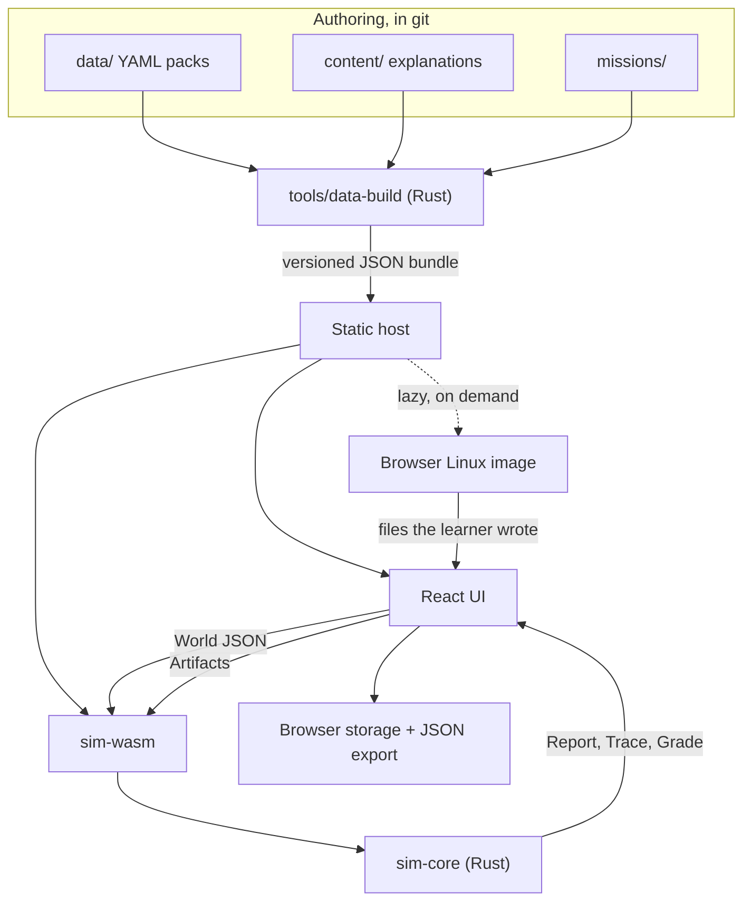

# Architecture

How the system's parts fit and what each is allowed to do. **Status (2026-11-10): no code exists yet.** This is the target design. Read [Handoff.md](Handoff.md) first for current state and for which decisions are confirmed.

## System map



There is no backend, no account system and no runtime API. Everything the app needs is a static file.

## Repo layout (target)

```
crates/sim-core/      Rust library. Pure logic. No wasm, DOM, clock or randomness.
crates/sim-wasm/      Thin wasm-bindgen wrapper: JSON in, JSON out.
tools/data-build/     Validates data packs and emits the JSON bundle.
app/                  TypeScript + React + React Flow UI.
data/archetypes/      Generic teaching machines, one file each.
data/devices/         Real devices, one file each. Empty at launch.
data/isps/            Indian ISP profiles, one file each.
data/services/        Software learners place on hosts.
data/power/           State tariff presets and outage scenarios.
content/explanations/ Teaching text, one Markdown file per concept.
missions/             Mission definitions, one directory each.
curriculum/           Whole-curriculum documentation in Markdown.
context-docs/         These files.
```

## Boundaries

1. **The UI never decides validity or outcome.** It renders what the core returns.
2. **The core is deterministic.** Same input, same bytes out. No clock, randomness, floats in decisions or hash-ordered iteration (use `BTreeMap`).
3. **The core never touches the DOM or the network**, and is testable as a plain Rust library.
4. **Rules read capabilities, never product names.** A rule may ask `nic_count` or `arch`, never `model == "EQ12"`. This is what makes device data modular.
5. **Learner data stays in the browser.** The app never transmits a learner's IP address, ISP result, or build.
6. **No LLM in the runtime.** Verdicts come from tested rules.

## World model

The world is **one graph**, not three stacked layers. Nodes are physical machines, virtual machines, containers, services, network segments and the ISP. Edges are cables, hosting (`runs_on`) and logical dependencies.

The physical → network → services split survives as **curriculum order and UI grouping only**. It cannot be an evaluation order because real homelabs cross it: a firewall VM is a hosted workload acting as the network's router, and Pi-hole is a service providing the network's DNS.

Hosting nests explicitly: `machine → hypervisor → VM or LXC → container runtime → service`. Virtual bridges are network segments.

### Evaluation

```rust
pub fn evaluate(world: &World, bundle: &Bundle) -> Report;
pub fn trace(world: &World, intent: &Intent, bundle: &Bundle) -> Trace;
pub fn grade(mission: &Mission, world: &World, artifacts: &Artifacts, bundle: &Bundle) -> Grade;
```

`evaluate` derives facts (addresses, routes, DNS, reachability) by iterating to a **fixed point** with a bounded iteration count and stable ordering, then runs rules over the result. Hitting the bound is a reported error, never a silent stop.

A half-built world is normal. Rules report what they can, and nothing gates later checks. Only true physical impossibilities (a cable that cannot fit that port) are rejected at the moment of the action.

### Verdicts are three-valued

```rust
pub enum Status { Pass, Fail, Unknown }

pub struct Finding {
    rule_id: RuleId,
    status: Status,
    severity: Severity,        // Error | Warning | Info
    involved: Vec<NodeId>,
    explanation_id: ExplanationId,
    provenance: Provenance,    // Official | Community | Teaching | LineCheck
}
```

Missing data produces `Unknown`, which the UI must show. **A rule may never treat a missing value as a pass.** This is the main guard against false "this will work" answers.

## Network logic for the remote-access track

Logic-level, not packet-level. The core models what decides reachability:

- Address classes: LAN private, CGNAT `100.64.0.0/10` (RFC 6598), public IPv4, global IPv6.
- NAT mapping tables at the home router and, when present, the ISP's carrier NAT. An inbound packet needs an existing mapping or a forward rule at **every** NAT it crosses.
- Outbound-initiated connections create mappings. This is why tunnels and overlay VPNs work behind CGNAT, and the concept the track teaches.
- Tunnels and overlays as logical links (WireGuard, Tailscale-style overlay, Cloudflare-Tunnel-style connector, relay through a VPS).
- IPv6 reachability, including whether the client side has IPv6 and whether the router firewall admits it.
- Simple allow or deny firewall rules, DNS names, and port conflicts on one host.

`trace` returns an ordered list of steps. The UI only plays it back ([Animations.md](Animations.md)).

```rust
pub struct TraceStep {
    at: NodeId,
    action: StepAction,      // Send | Forward | Rewrite | Encapsulate | Drop | Deliver
    packet: PacketView,      // source and destination as seen at this hop
    reason: Option<ExplanationId>,
}
```

## Real terminal

Browser Linux has no real internet path, so it **cannot** sit behind CGNAT or join a tailnet. The division of work is:

- The learner runs real commands and edits real files in browser Linux.
- On "Check", the UI reads the files the mission names and passes them to `grade` as `Artifacts`.
- Rust parsers (WireGuard config, the compose subset, `sshd_config` subset) turn files into facts in the world, and the logic sim decides whether the connection would work.

```ts
interface TerminalHost {
  boot(image: GuestImage): Promise<void>;
  writeInput(data: string): void;
  onOutput(cb: (data: string) => void): void;
  readFile(path: string): Promise<Uint8Array>;
  writeFile(path: string, data: Uint8Array): Promise<void>;
  dispose(): void;
}
```

**Default engine: [v86](https://github.com/copy/v86)** (BSD-2-Clause). It exposes `read_file`, `create_file` and `serial0_send`. A code search of its repo found no `SharedArrayBuffer` use, so it should work without cross-origin isolation headers. Limit: 32-bit guest. [container2wasm](https://github.com/container2wasm/container2wasm) (Apache-2.0) is the fallback. The Phase 1 spike confirms the choice. Keep the interface engine-neutral.

Because grading reads artifacts rather than the VM, a **plain text editor can stand in for the terminal** on devices that cannot run it. The same grader applies.

The guest image must be small, lazy-loaded, and started only on request, showing its download size first.

## Data packs and the modularity contract

Adding hardware must be easy. **Adding a device means adding one YAML file and running the data build. It must never require a code change.** CI enforces this with a test that loads every pack.

One schema covers archetypes and real devices. They differ only in sourcing:

```yaml
# data/archetypes/single-nic-mini-pc.yaml
id: single-nic-mini-pc
kind: archetype              # archetype | device
label: Single-NIC mini PC
capabilities:
  arch: x86_64
  ram_gb: 16
  nic: [{ speed_mbps: 1000 }]
  virtualization: true
  igpu_transcode: unknown
power: { idle_w: 8, load_w: 25 }
```

`kind: device` additionally requires a source URL and `retrieved_at` for every capability value. Without a source, the value is absent and rules return `Unknown`. Archetypes are labelled in the UI as teaching models, not products. Rust types are the single schema definition, and JSON Schema for editors is generated from them.

Data lives in YAML in git, not Postgres, so anyone can contribute by PR and every change is reviewable. CI checks schema validity and flags dead source links.

### ISP profiles

ISP behaviour varies by plan, city and time, so a profile states dated, sourced claims and never a flat fact:

```yaml
# data/isps/example.yaml (shape only)
id: example-isp-fibre-home
claims:
  ipv4_cgnat:   { value: likely, confidence: low, checked: 2026-11-10, sources: [https://...] }
  static_ipv4:  { value: unknown }
  ipv6_default: { value: varies }
```

`value` is one of `yes | no | likely | varies | unknown`. The profile is only the **default**. The learner's own line check overrides it for their session, with `Provenance::LineCheck`. Only the yes/no outcome is used; the app never asks for the address itself.

### Power

Yearly cost uses a learner-editable rate, defaulted from dated state tariff presets (`data/power/`). Slab tariffs are simplified to one effective rate, labelled as an estimate. Outage scenarios model duration, UPS or inverter runtime from load, and whether machines and services return afterwards.

## Licensing and provenance

| Part | Licence |
|---|---|
| Code, including anything reused from HLBuilder | AGPL-3.0 |
| `data/`, `content/`, `missions/`, `curriculum/` | CC BY-SA 4.0 |

- Contributions use a **DCO sign-off**, with no CLA.
- The app footer links to the source for the running version (AGPL network clause).
- `THIRD_PARTY.md` lists every file reused from HLBuilder with its origin path and commit, and copied files keep their notices.
- The guest image ships GPL software (Linux and userland), so its corresponding sources or a written offer must be published with it.

## Reuse from HLBuilder

New repo, selective copying, **not a fork**. [HLBuilder](https://github.com/Butterski/homelab-builder) is AGPL-3.0 with a React 19, `@xyflow/react` 12 and Zustand frontend, so the UI stack matches. Its Go backend, Postgres, Google login and IPAM service are not reused.

The Phase 1 audit found nothing that needs copying yet. File-by-file results are in [Handoff.md](Handoff.md). `builder-store.ts` is large and autosaves to an API, so expect to borrow ideas, not code.

Validity logic must not be copied into the UI, even if it exists there, because of boundary 1. Do not import `hardware_seed.json` as fact: its data source is not stated, which breaks the sourcing rule.

## Hosting and budgets

Static hosting on Cloudflare Pages or GitHub Pages. Prefer Cloudflare Pages if the spike finds cross-origin isolation headers are needed, since GitHub Pages cannot set them.

Starting targets, to be confirmed against real devices in Phase 1:

| Budget | Target |
|---|---|
| App + core, gzipped, before any mission | under 500 KB |
| `evaluate` on a mission-sized world | under 16 ms on a low-end Android phone |
| Guest image first download | under 30 MB, shown before starting |

Service-worker caching keeps repeat visits cheap on metered connections. Progress lives in browser storage with every access wrapped in try/catch, plus JSON export and import, because browser storage can be cleared.

## Not in this architecture

Parked deliberately (see [Handoff.md](Handoff.md)): accounts, hosted SSH lab servers, a live price feed, mocked Proxmox or router admin UIs, and an in-app forum.
